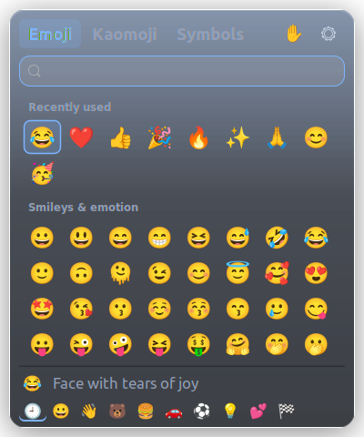
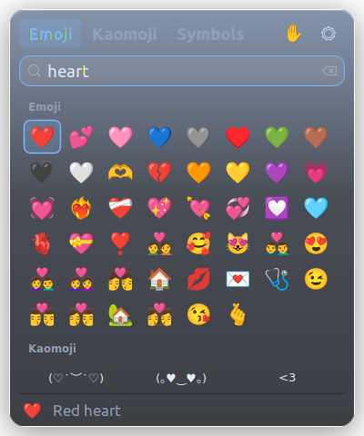
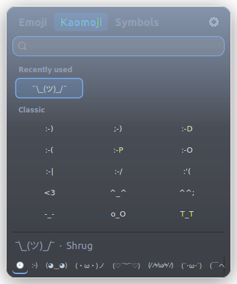

<div align="center">

# SuperDot

**Emoji for Linux.** The Windows Win+. emoji panel: same panel, same keys.

Press <kbd>Super</kbd> + <kbd>.</kbd> in any app, type to search, pick an emoji, and it's typed where you were writing.
Ubuntu, Linux Mint, Debian, Fedora, Arch, openSUSE and more.

**[Website and live demo →](https://saikatnjm.github.io/superdot/)**


<picture>
  <source media="(prefers-color-scheme: light)" srcset="docs/screenshot-light.png">
  
</picture>

</div>

## Why SuperDot

Typing an emoji on Linux usually means a web search and copy-paste, or remembering Unicode codes. SuperDot copies how Windows does it:

| | Windows (Win+.) | SuperDot |
|---|:---:|:---:|
| Emoji panel on <kbd>Win</kbd>/<kbd>Super</kbd> + <kbd>.</kbd> | ✓ | ✓ |
| Typed straight into the app you were using | ✓ | ✓ |
| Start typing to search ("heart", "cat", "party") | ✓ | ✓ |
| Recently used first | ✓ | ✓ |
| Skin tones | ✓ | ✓ |
| Kaomoji ¯\\\_(ツ)\_/¯ and symbols (→ € ° ± Ω é…) | ✓ | ✓ |
| Arrow keys, <kbd>Enter</kbd>, <kbd>Esc</kbd> | ✓ | ✓ |
| Search finds emoji, kaomoji **and** symbols at once | ✗ | ✓ |
| Your clipboard is left as it was | ✓ | ✓ |
| Hides emoji your font can't draw (no empty boxes) | ✓ | ✓ |
| Pick several in a row | ✓ | ✓ |
| Resize the panel | ✗ | ✓ |
| Glass look (see-through panel; blurred on KDE Plasma) | ✓ | ✓ |
| Pick your **own** shortcut | ✗ | ✓ |
| Theme: System / Light / Dark | ✓ | ✓ |
| Six colour palettes (Azure, Graphite, Emerald, Amber, Rose, Violet) | ✗ | ✓ |
| Free and open source | ✗ | ✓ |

<p align="center">
  
  
</p>

## Install

### Ubuntu, Linux Mint, Debian, Pop!_OS, Zorin, elementary

Download **[superdot_amd64.deb](https://github.com/saikatnjm/superdot/releases/latest/download/superdot_amd64.deb)** and double-click it, or:

```bash
sudo apt install ./superdot_amd64.deb
```

### Fedora, openSUSE

Download **[superdot.x86_64.rpm](https://github.com/saikatnjm/superdot/releases/latest/download/superdot.x86_64.rpm)**, then:

```bash
sudo dnf install ./superdot.x86_64.rpm
```

On openSUSE use `sudo zypper install ./superdot.x86_64.rpm`.

### Arch, Manjaro, EndeavourOS

Download **[superdot-x86_64.pkg.tar.zst](https://github.com/saikatnjm/superdot/releases/latest/download/superdot-x86_64.pkg.tar.zst)**, then:

```bash
sudo pacman -U superdot-x86_64.pkg.tar.zst
```

or build it yourself from [`packaging/arch/PKGBUILD`](packaging/arch/PKGBUILD) with `makepkg -si`.

After installing a package, **log out and back in once** (or open SuperDot from your app menu). The <kbd>Super</kbd> + <kbd>.</kbd> shortcut is set up the first time it runs.

### Any other distro: install script

No root install, everything goes to your home folder. It asks for your password once, to let SuperDot type into Wayland apps.

```bash
git clone https://github.com/saikatnjm/superdot.git
cd superdot
./install.sh
```

Options: `./install.sh --hotkey "<Ctrl><Alt>e"` for another shortcut, `./install.sh --no-sudo` to skip the password step (picking an emoji then copies it and you press <kbd>Ctrl</kbd> + <kbd>V</kbd>).

## Use it

| Key | What it does |
|---|---|
| <kbd>Super</kbd> + <kbd>.</kbd> | Open or close the panel |
| type | Search emoji, kaomoji and symbols by name or keyword |
| <kbd>←</kbd> <kbd>↑</kbd> <kbd>↓</kbd> <kbd>→</kbd>, <kbd>Page Up</kbd> / <kbd>Page Down</kbd> | Move around |
| <kbd>Enter</kbd> or click | Insert it where you were typing; the panel stays open for the next one |
| <kbd>Shift</kbd> + <kbd>Enter</kbd> or <kbd>Shift</kbd> + click | Insert and close the panel |
| <kbd>Tab</kbd> | Emoji → Kaomoji → Symbols |
| <kbd>Esc</kbd> or click outside | Clear the search, then close |
| drag an edge or corner | Resize the panel (remembered) |
| drag the top row | Move the panel; double-click it to reset size and place |

The ✋ button picks your skin tone. The ⚙ menu changes the shortcut, theme, and what happens when you pick (type it, or copy only).

From a terminal or your own key bindings:

```bash
superdot --insert "¯\_(ツ)_/¯"   # type text into the focused app
superdot --search heart          # open with a search
superdot --tab kaomoji           # open on a tab
superdot --doctor                # check the setup
```

## Works on

| Desktop | Shortcut set up automatically |
|---|---|
| GNOME (Ubuntu, Fedora, Debian, Pop!_OS…), Budgie, Pantheon | ✓ |
| Cinnamon (Linux Mint) | ✓ |
| KDE Plasma 5 and 6 (frees Plasma's own emoji picker from Meta+. and gives it back on uninstall) | ✓ |
| MATE, Xfce | ✓ |
| Hyprland, Sway, i3, COSMIC | prints the line to add to your config |

Wayland and X11 both work. The panel runs through XWayland, which every major desktop ships.

## How it works

0. The panel never takes keyboard focus itself (an invisible 1-pixel helper window does), so it can stay on screen, without flicker, while your app receives each emoji.
1. When the panel opens, SuperDot remembers what's on your clipboard.
2. When you pick an emoji it puts it on the clipboard, marked like a password so clipboard managers (SuperV, Klipper, CopyQ) don't record it.
3. It presses <kbd>Shift</kbd> + <kbd>Insert</kbd> in the app you came from, which works in browsers, editors, office apps *and* terminals.
4. As soon as the app has read the emoji, your previous clipboard comes back.

On Wayland, pressing keys for you needs access to `/dev/uinput`: the installer adds a one-line udev rule (`70-superdot-uinput.rules`) that gives it to the logged-in user. Without it SuperDot still works, but copies only.

SuperDot is one small C program (GTK 3). The emoji list (Unicode 18.0 with CLDR search keywords) is built in, so there are no data files, no Python while running, and no network access.

## Settings

`~/.config/superdot/config.ini`, also editable from the ⚙ menu:

| Key | Default | |
|---|---|---|
| `hotkey` | `<Super>period` | change it from the ⚙ menu or `superdot-setup --hotkey '<Ctrl><Alt>e'` |
| `paste_keys` | `shift+insert` | `ctrl+v`, `ctrl+shift+v`, or `none` (copy only) |
| `skin_tone` | `0` | 0 default yellow, 1 light … 5 dark |
| `stay_open` | `true` | stay open after picking, to pick several; `false` closes after one |
| `width`, `height` | `400`, `480` | panel size |
| `restore_clipboard` | `true` | put back what you had copied |
| `theme` | `auto` | `light`, `dark` |
| `color` | `azure` | `graphite`, `emerald`, `amber`, `rose`, `violet` |
| `glass` | `true` | see-through glass panel; `false` for a solid one |

Recently used emoji are kept in `~/.local/share/superdot/recent.txt`.

## Uninstall

- Package: `sudo apt remove superdot`, `sudo dnf remove superdot` or `sudo pacman -R superdot`. Your desktop shortcuts are put back.
- Install script: `~/.local/lib/superdot/uninstall.sh` (add `--purge` to also delete recently used and settings).

## Build from source

```bash
sudo apt install build-essential pkg-config libgtk-3-dev   # Fedora: gcc make gtk3-devel libX11-devel
make
./superdot --daemon &
./superdot
```

`make data` re-downloads the latest Unicode emoji list and CLDR keywords and regenerates `emoji-data.h`. Kaomoji and symbols live in [`data/kaomoji.txt`](data/kaomoji.txt) and [`data/symbols.txt`](data/symbols.txt), so adding your favourites is easy.

## License

MIT ([LICENSE](LICENSE)). Emoji names and keywords come from Unicode's [emoji-test.txt](https://unicode.org/Public/emoji/latest/emoji-test.txt) and [CLDR](https://github.com/unicode-org/cldr) annotations, under the Unicode License v3 ([LICENSES/Unicode-3.0.txt](LICENSES/Unicode-3.0.txt)).
